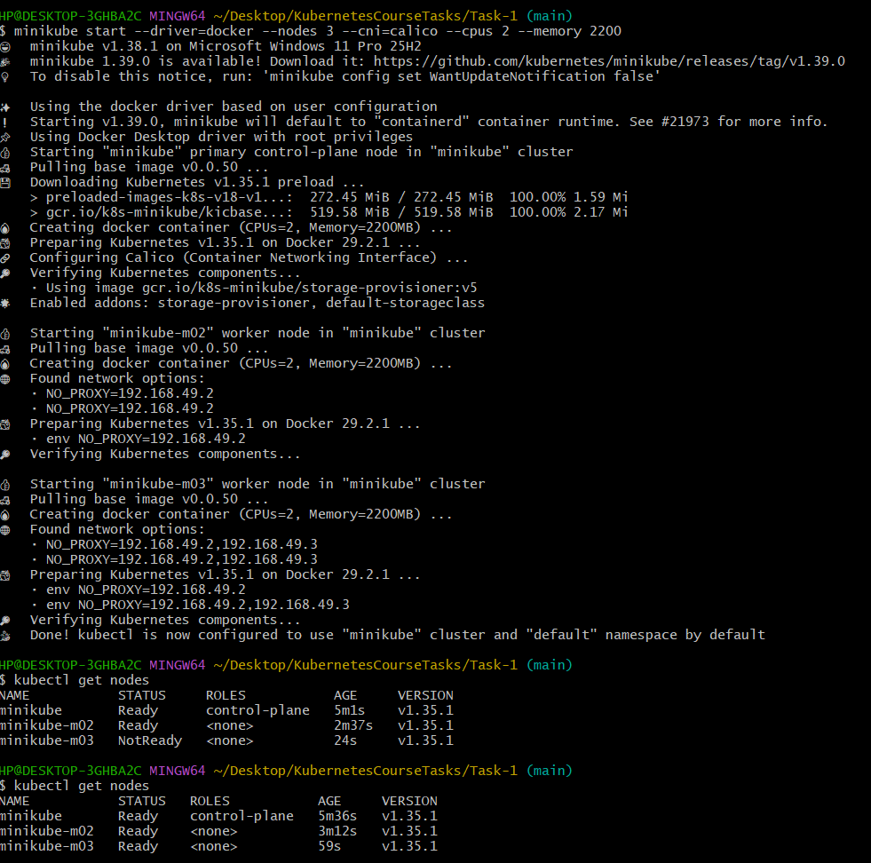
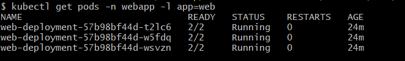
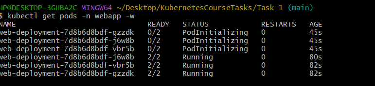
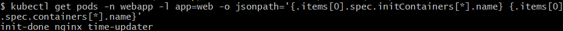
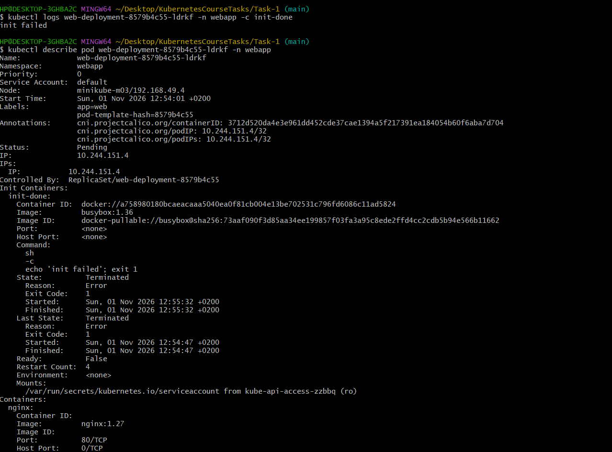
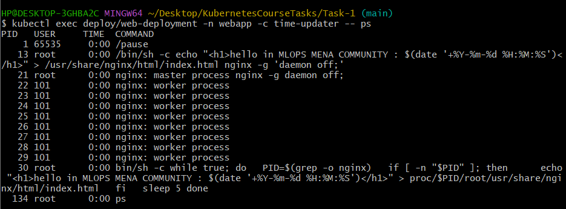
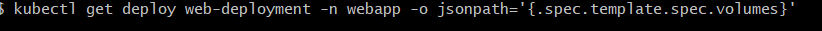

# Task 1: Multi-container Pods (Init Container & Sidecar)

## Overview

An nginx "hello" page on a 3-node minikube cluster. Each Pod has three containers and no volume:

| Container | Type | Job |
|-----------|------|-----|
| `init-done` | Init container | Prints `done` and exits |
| `nginx` | Main container | Writes `index.html` with the time, then serves it on port 80 |
| `time-updater` | Sidecar | Rewrites `index.html` every 5 seconds via `/proc/<nginx-pid>/root` |

The Pod uses `shareProcessNamespace: true`, so the sidecar can see the nginx process, and the `SYS_PTRACE` capability lets it write into the nginx container's filesystem.

## Files

- `deployment.yaml`: the Deployment manifest
- `screenshots/`: proof of each step

## Steps

### 1. Create the cluster

```bash
minikube start --driver=docker --nodes 3 --cni=calico --cpus 2 --memory 2200
kubectl get nodes
```



### 2. Create the namespace

```bash
kubectl create namespace webapp
```

### 3. Deploy

```bash
kubectl apply -f deployment.yaml
kubectl get pods -n webapp -w
kubectl port-forward -n webapp deploy/web-deployment 8080:80
```




## Verification

| # | Check | Screenshot |
|---|-------|------------|
| 1 | 3 nodes Ready |  |
| 2 | Deployment READY 3/3 |  |
| 3 | 3 Pods `2/2 Running` |  |
| 4 | Container names |  |
| 5 | Init log prints `done` |  |
| 6 | Sidecar sees nginx (`ps`) |  |
| 7 | Time updates (two reads, 5 s apart) |  |
| 8 | No volumes |  |

## Step 5: Failing init container

I changed only the init container command to:

```yaml
command: ["sh", "-c", "echo 'init failed'; exit 1"]
```

and re-applied the file with `kubectl apply -f deployment.yaml`.


### Answers

- **Which status does the new Pod show?** `Init:Error`, then `Init:CrashLoopBackOff`, with READY `0/2`.
- **Do `nginx` and `time-updater` start?** No. Init containers must finish successfully before the other containers start, so they stay in `PodInitializing` and never run.
- **Is the page still reachable, and why?** Yes. The Deployment does a rolling update: it only removes an old Pod after a new one is Ready. The new Pod never becomes Ready, so the 3 old Pods stay `2/2 Running` and keep serving traffic.

## Step 6: Fix

I restored `command: ["sh", "-c", "echo done"]` and ran `kubectl apply -f deployment.yaml` again.


## Troubleshooting notes

- On Windows Git Bash, paths starting with `/` get rewritten (e.g. `/usr/...` becomes `C:/Program Files/Git/usr/...`). Using `sh -c '...'` inside `kubectl exec` avoids this.
- My first sidecar manifest had `bin/sh` and `proc/` (missing the leading `/`) and used `grep` instead of `pgrep`, so the time never updated. Fixing the loop solved it.
- An old minikube profile blocked the 3-node start; `minikube delete --all --purge` and starting fresh fixed it.
