# FastAPI + MySQL with ConfigMap, Secret & Ingress

## Overview

A FastAPI guestbook app with one MySQL server, deployed on the 3-node minikube cluster from Task 1:

- MySQL stores its data on a **PV + PVC** (`mysql-pv` / `mysql-pvc`, pinned to `minikube-m02`).
- App settings are in a **ConfigMap** (`webapp-config`), MySQL credentials in a **Secret** (`mysql-secret`).
- Users reach the app through an **Ingress** (`webapp-ingress`, class `nginx`).

```
Browser -> Ingress Controller -> Ingress webapp-ingress -> Service webapp-api (80 -> 8000) -> 2 app Pods
                                                                                  |
                                                         Service mysql (3306) -> MySQL Pod -> mysql-pvc -> mysql-pv
```

## Files

| File | Content |
|------|---------|
| `namespace.yaml` | Namespace `webapp-stack` |
| `secret.yaml` | Secret `mysql-secret` |
| `configmap.yaml` | ConfigMap `webapp-config` |
| `pv-pvc.yaml` | PV `mysql-pv` (with nodeAffinity) + PVC `mysql-pvc` |
| `mysql.yaml` | MySQL Deployment + Service |
| `webapp.yaml` | App Deployment + Service |
| `ingress.yaml` | Ingress `webapp-ingress` |
| `wipe.yaml` | Temporary Pod used to empty the PVC (troubleshooting) |
| `mysql/Dockerfile.fix` | Copy of the provided Dockerfile with one extra line (see Troubleshooting) |

---

## Steps

### 1. Build the images and load them into minikube

```bash
docker build -t webapp-api:task2 ./webapp
docker build -t webapp-mysql:task2 ./mysql
minikube image load webapp-api:task2
minikube image load webapp-mysql:task2
minikube image ls
```

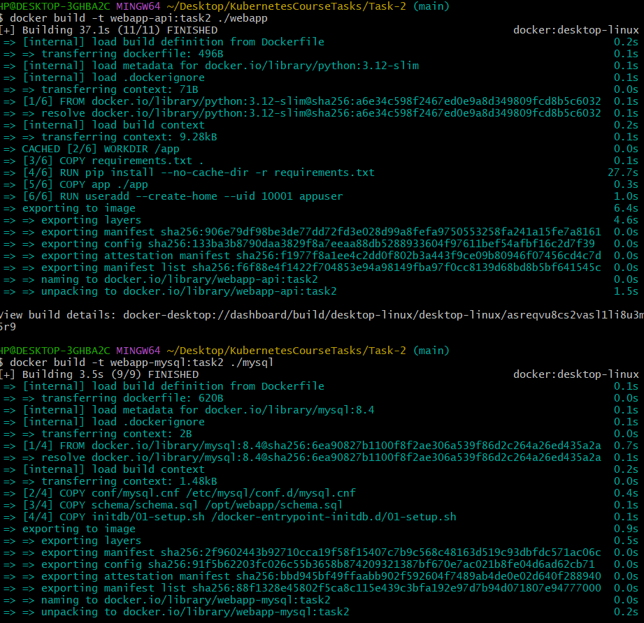

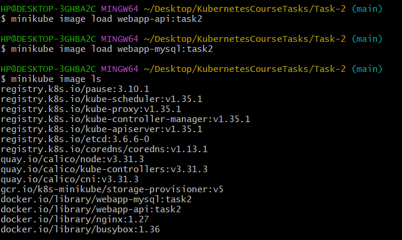

### 2. Namespace, Secret and ConfigMap

```bash
kubectl apply -f namespace.yaml
kubectl apply -f secret.yaml
kubectl apply -f configmap.yaml
```

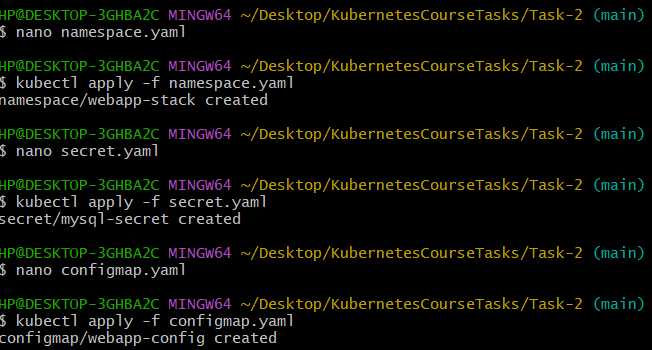

### 3. PV and PVC

The PV is pinned to the worker `minikube-m02` with `nodeAffinity`, because a `hostPath` folder exists on one node only. Without it, the MySQL Pod could start on another node and lose its data.

```bash
kubectl get nodes -L kubernetes.io/hostname
kubectl apply -f pv-pvc.yaml
kubectl get pv mysql-pv
kubectl get pvc mysql-pvc -n webapp-stack
```

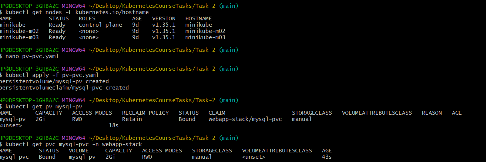

### 4. MySQL Deployment and Service

`strategy: Recreate`, env from the Secret and ConfigMap, PVC mounted at `/var/lib/mysql`, readiness probe `mysqladmin ping`.

```bash
kubectl apply -f mysql.yaml
kubectl logs deploy/mysql -n webapp-stack
kubectl get endpoints mysql -n webapp-stack
```

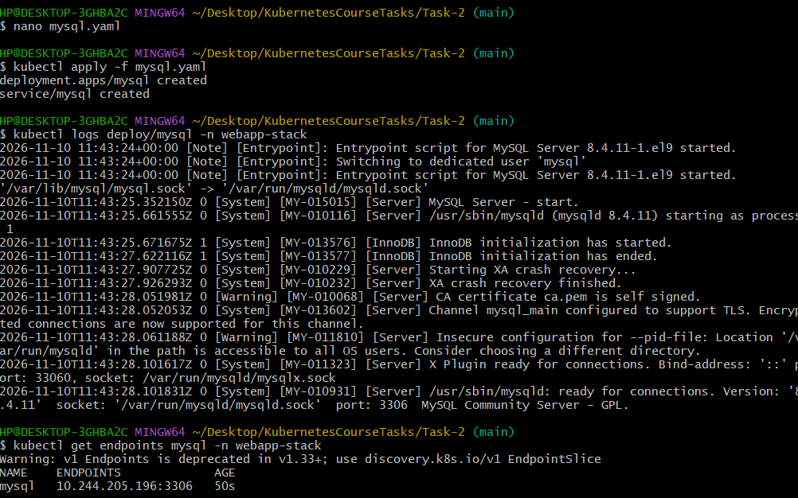

### 5. App Deployment and Service

2 replicas, all ConfigMap keys through `envFrom`, `MYSQL_USER` / `MYSQL_PASSWORD` from the Secret, probes on `/health`.

```bash
kubectl apply -f webapp.yaml
kubectl exec -n webapp-stack deploy/webapp-api -- env | grep -E "APP_|MYSQL_"
kubectl get endpoints webapp-api -n webapp-stack
```

`MYSQL_PORT=3306` comes from the ConfigMap and replaces the `MYSQL_PORT=tcp://...` variable that Kubernetes injects for the Service `mysql`.

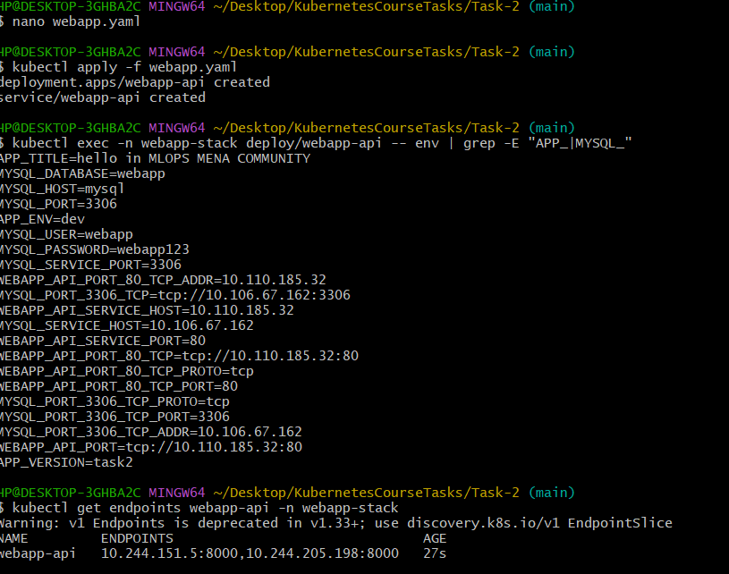

### 6. Ingress Controller and Ingress

```bash
minikube addons enable ingress
kubectl get pods -n ingress-nginx
kubectl get ingressclass
```

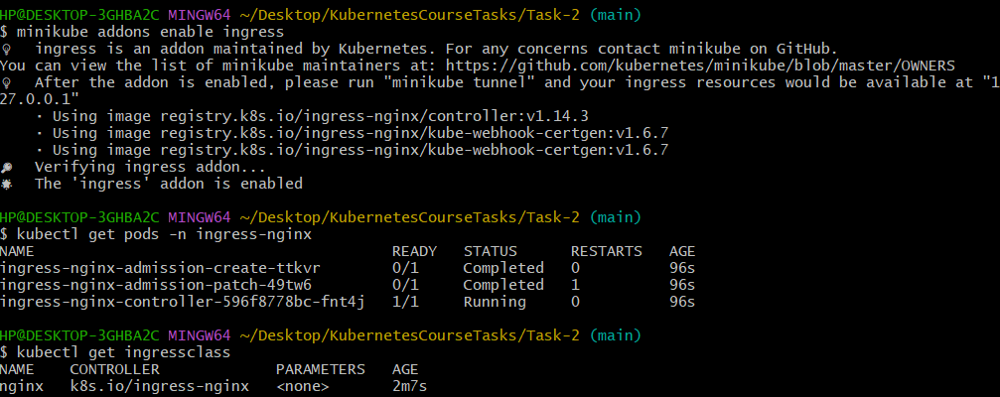

```bash
kubectl apply -f ingress.yaml
kubectl get ingress webapp-ingress -n webapp-stack
```

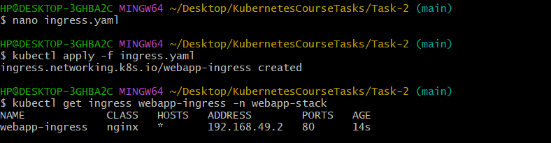

### 7. Open the app

```bash
kubectl get pods -n webapp-stack -w
kubectl port-forward -n ingress-nginx svc/ingress-nginx-controller 8080:80
```

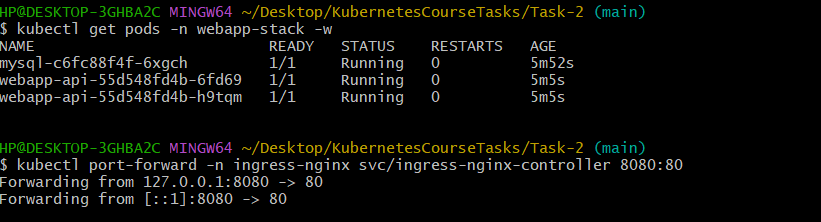

Open <http://localhost:8080>:

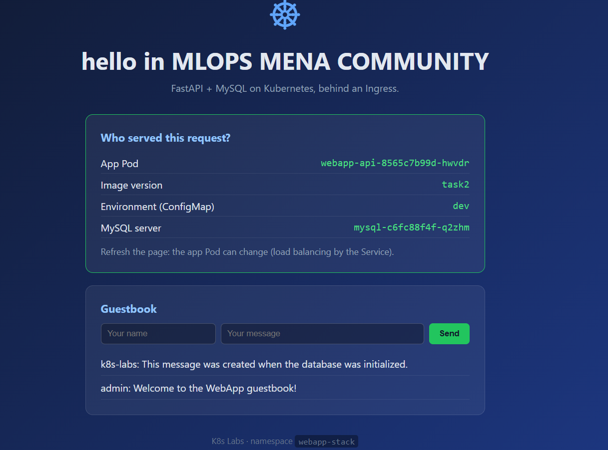

---

## Verification

| # | Check | Result |
|---|-------|--------|
| 1 | Images loaded | `webapp-api:task2`, `webapp-mysql:task2` listed (screenshot 02) |
| 2 | Secret and ConfigMap | Created (screenshot 03) |
| 3 | PV and PVC bound | `Bound`, 2Gi, claim `webapp-stack/mysql-pvc` (screenshot 04) |
| 4 | Deployments ready | mysql 1/1, webapp-api 2/2 (screenshot 10) |
| 5 | MySQL on the PV node | see below |
| 6 | App env | `APP_TITLE`, `MYSQL_HOST=mysql`, `MYSQL_USER`, `MYSQL_PASSWORD` (screenshot 07) |
| 7 | Default data | 2 default messages in `webapp.messages` (screenshot below) |
| 8 | Ingress | CLASS `nginx`, ADDRESS filled (screenshot 09) |
| 9-11 | API: info, write, read | see below |
| 12 | Data survives a restart | see below |

### Env variables match between MySQL and the app

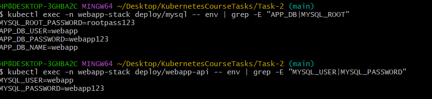

### Default data and database user

The user `webapp` exists and `webapp.messages` has the 2 default messages:

```bash
kubectl exec -n webapp-stack deploy/mysql -- sh -c 'mysql -uroot -p"$MYSQL_ROOT_PASSWORD" -e "SELECT user,host FROM mysql.user; SELECT * FROM webapp.messages;"'
```

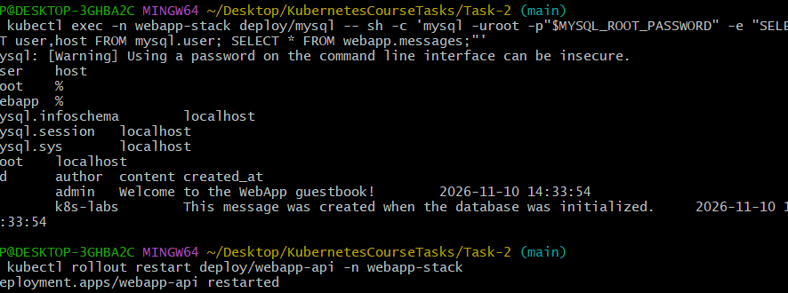

### MySQL Pod runs on `minikube-m02`

```bash
kubectl get pods -n webapp-stack -l app=mysql -o wide
```

<!-- TODO: add screenshot images/14-mysql-node.png -->
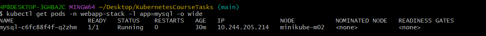

### API checks

```bash
curl http://localhost:8080/api/info
curl -X POST http://localhost:8080/api/messages -H "Content-Type: application/json" -d '{"author":"student","content":"hello"}'
curl http://localhost:8080/api/messages
```

<!-- TODO: add screenshot images/15-api.png -->
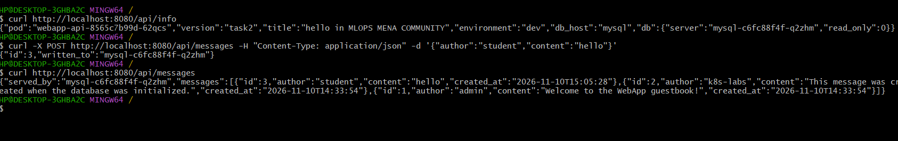

### Data survives a restart

```bash
kubectl delete pod -n webapp-stack -l app=mysql
kubectl get pods -n webapp-stack -w
curl http://localhost:8080/api/messages
```

<!-- TODO: add screenshot images/16-persistence.png -->
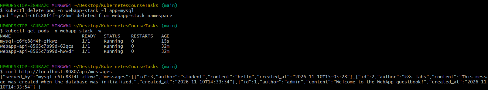

---

## Troubleshooting (problems I hit and how I fixed them)

### 1. `Access denied for user 'webapp'` and `Unknown database 'webapp'`

The app showed `error: (1045, "Access denied for user 'webapp'...")`. The env variables of MySQL and the app were identical, so the problem was inside MySQL: the database and the app user did not exist.

MySQL creates the database and the user only on the **first start with an empty data folder**. The folder had old data, so the init script was skipped.

### 2. `rm -rf` did not delete anything (Git Bash path conversion)

I ran minikube commands from Git Bash. It converts `/data/webapp-mysql` into `C:/Program Files/Git/data/webapp-mysql`, so the folder on the node was never cleaned. Fix: use `MSYS_NO_PATHCONV=1` or `//data/...`. I also emptied the volume from inside Kubernetes with a temporary Pod (`wipe.yaml`) that mounts `mysql-pvc` and deletes its content, which avoids path problems completely.

### 3. Init script failed: `mysql_note: command not found`, `docker_process_sql: command not found`

After the volume was really empty, the logs showed that `/docker-entrypoint-initdb.d/01-setup.sh` ran but its helper functions were missing. The official entrypoint **sources** `.sh` files that are not executable, and **executes** the ones that are. Files copied from Windows are executable inside the image, so the script ran as a separate process without the functions.

Fix without changing the provided files: `mysql/Dockerfile.fix` is a copy of the original Dockerfile plus one line that removes the execute bit:

```dockerfile
RUN find /docker-entrypoint-initdb.d -name "*.sh" -exec chmod a-x {} +
```

```bash
docker build -f mysql/Dockerfile.fix -t webapp-mysql:task2 ./mysql
```

### 4. Docker engine hung, `corrupted shared library`, `not enough space on the disk`

The `C:` drive had only 0.6 GB free, caused by Docker's `docker_data.vhdx` (about 80 GB). This made the Docker engine hang, the loaded image get corrupted, and `minikube image load` fail. Fix: free space on `C:`, shrink the VHDX (`wsl --shutdown`, then compact the disk), restart Docker Desktop, then rebuild and reload the image:

```bash
minikube image rm webapp-mysql:task2
minikube image load webapp-mysql:task2
```

After that I emptied the PVC with `wipe.yaml`, scaled MySQL back to 1 replica, the init script ran, and the guestbook worked.

---

