# Task 3: MySQL Read Replicas, RBAC, NetworkPolicy & Helm
 
## 1. What I built
 # Task 3: MySQL Read Replicas, RBAC, NetworkPolicy & Helm

## 1. What I built

I upgraded the Task 2 stack:

- MySQL is now split into **`mysql-write`** (1 Pod, accepts writes) and **`mysql-read`** (2 Pods, read-only copies).
- The read servers copy every change from the write server (**GTID replication**).
- The app sends writes to `mysql-write` and reads to `mysql-read` (new ConfigMap keys `MYSQL_WRITE_HOST` and `MYSQL_READ_HOST`).
- I deployed as a new user **`dev-user`** that has rights only in `webapp-stack` (**RBAC**).
- A **NetworkPolicy** allows port 3306 only from the app and from MySQL Pods.
- Everything is packaged in one **Helm chart** (`webapp-stack`) and installed as release `webapp`.

## 2. Project structure

```
Task-3/
├── mysql/          # MySQL image
├── webapp/         # FastAPI image
├── rbac/rbac.yaml  # Role, RoleBinding, ClusterRole, ClusterRoleBinding
├── scripts/        # create-user.sh, kubeconfig.sh
├── webapp-stack/   # Helm chart (Chart.yaml, values.yaml, templates/)
└── images/         # screenshots
```

## 3. Steps and what each one means

### Step 1: Clean Task 2 (admin)

I deleted the Task 2 objects, the PV, and the MySQL data folder.

**Why:** Helm refuses to take over objects it did not create (error `invalid ownership metadata`), and the write server must start with an empty data folder.

 The cleanup commands, and the namespace showing only `kube-root-ca.crt`:

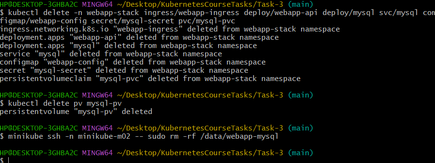

### Step 2: Build and load the `task3` images

Built `webapp-api:task3` and `webapp-mysql:task3`, then loaded them into minikube.

**Why:** minikube cannot pull local images from my Docker, so I load them. A new tag per release lets me go back to `task2` anytime.

 `minikube image ls` showing the task2 and task3 images:


### Step 3: Create `dev-user`

Kubernetes has no "user" object. A user is anyone with a certificate signed by the cluster CA.
`CN` = user name, `O` = group. Flow: private key, then CSR, then CertificateSigningRequest, then approve, then signed `.crt`.

 The key/CSR creation and `kubectl get csr` showing `Approved,Issued`:

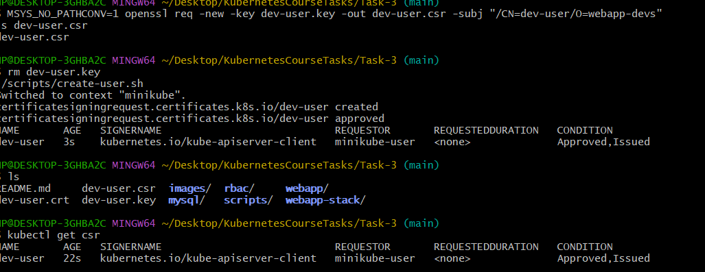

### Step 4: RBAC (admin)

- **Role `webapp-developer`**: rights only inside `webapp-stack`.
- **RoleBinding**: gives the Role to `dev-user`.
- **ClusterRole `pv-manager` + ClusterRoleBinding**: needed because a PV has no namespace.
- Helm stores each release as a Secret, so `dev-user` needs rights on Secrets.

 `kubectl apply -f rbac/rbac.yaml` output:

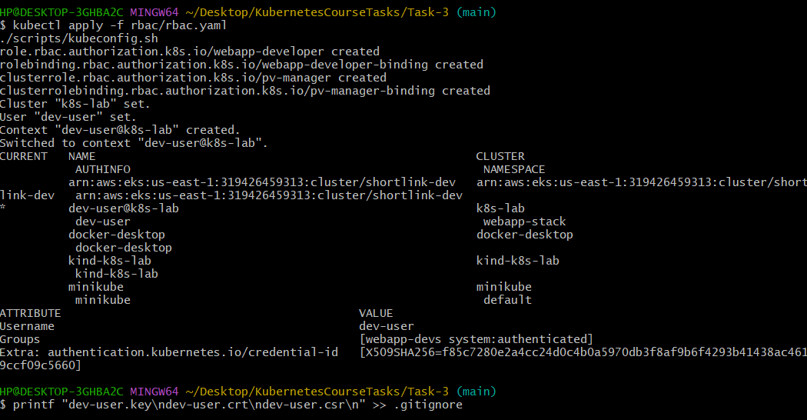

 The three `kubectl auth can-i` results (`yes`, `yes`, `no`):

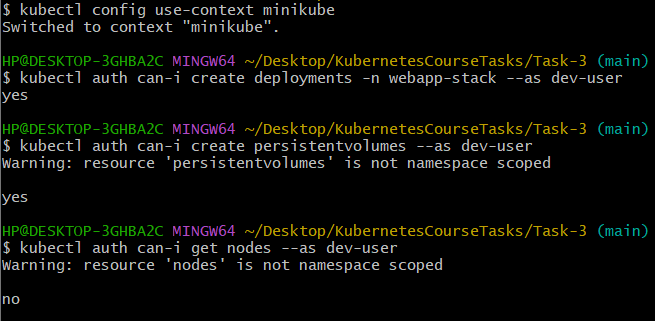

### Step 5: kubeconfig

Added cluster `k8s-lab`, user `dev-user`, context `dev-user@k8s-lab` (default namespace `webapp-stack`).
A context = cluster + user + namespace.

 The output of `kubeconfig.sh` ending with `kubectl auth whoami` (`dev-user`, group `webapp-devs`):

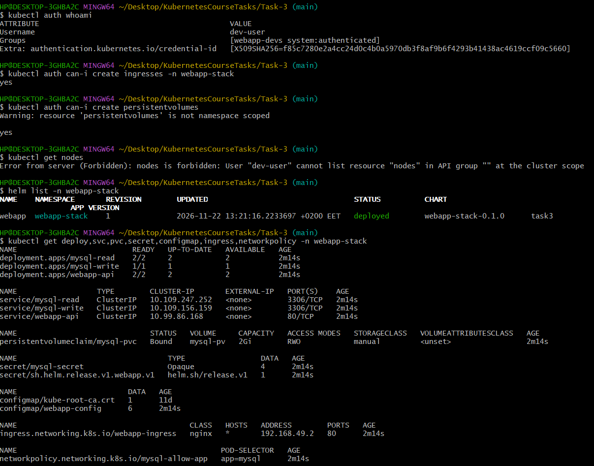

### Steps 6 to 11: YAML changes from Task 2

| Object | Change |
|---|---|
| Secret | added `replication-password` |
| ConfigMap | removed `MYSQL_HOST`, added `MYSQL_WRITE_HOST`, `MYSQL_READ_HOST` |
| PV / PVC | same as Task 2 (pinned to `minikube-m02` with nodeAffinity) |
| `mysql-write` | `MYSQL_ROLE=source`, `subPath: write`, strategy `Recreate` |
| `mysql-read` | `MYSQL_ROLE=replica`, `subPathExpr: read/$(POD_NAME)` |
| `webapp-api` | image `task3` only |
| NetworkPolicy | allow 3306 from `app: webapp-api` OR `app: mysql` |

Key ideas:

- **subPath / subPathExpr**: all MySQL Pods share one PVC, but two MySQL servers can never share a data folder. `subPath` gives the write server `write/`, and `subPathExpr` gives each read Pod its own `read/<pod-name>/`.
- **Downward API** (`fieldRef`): gives the Pod its own name and IP (`POD_NAME`, `POD_IP`). The IP builds a unique `server_id` for each replica.
- **Service selectors** include `role`, so `mysql-write` never sends traffic to read Pods.
- **NetworkPolicy**: once a Pod is selected by an Ingress policy, everything not allowed is blocked. Two items under one `from:` mean OR.

### Step 12: Helm chart

`helm create webapp-stack`, then I replaced the sample templates with my files. Replicas, images, passwords and sizes are in `values.yaml` and used as `{{ .Values... }}`. The namespace is `{{ .Release.Namespace }}`.

 `helm lint webapp-stack` (0 charts failed):

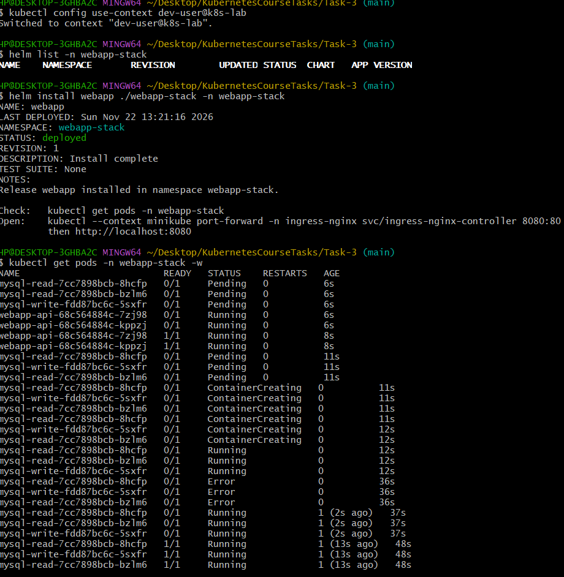

### Step 13: Install as `dev-user`

`helm install webapp ./webapp-stack -n webapp-stack`

 The install output (`STATUS: deployed`):


 `kubectl get pods -n webapp-stack` with all Pods `Running`:

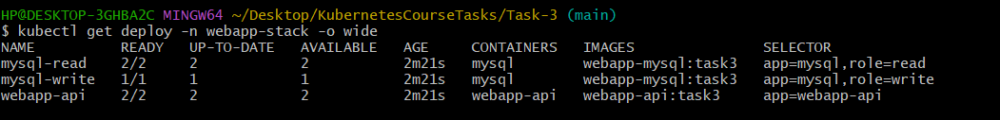

## 4. Problem I hit and how I fixed it

**Symptom:** after install, `SHOW REPLICA STATUS` was empty, `CREATE DATABASE test` worked on the replica, and the database `webapp` did not exist.

**Cause:** the MySQL entrypoint *sources* init scripts only if they are not executable. My `01-setup.sh` was executable (files copied from Windows), so it ran as a separate program and failed with `mysql_note: command not found` and `docker_process_sql: command not found`. Init is one-time, so the restart skipped it.

**Fix:** added `RUN chmod -x /docker-entrypoint-initdb.d/01-setup.sh` to the MySQL Dockerfile, rebuilt the image, uninstalled the release, wiped `/data/webapp-mysql`, and installed again.

**Lesson:** init scripts run only on an empty data folder, so after a failed first start you must wipe the data.

## 5. Verification

| # | Check | What the screenshot must show |
|---|---|---|
| 1 | Identity | `dev-user`, group `webapp-devs` |
| 2 | Rights inside | `yes`, `yes` |
| 3 | No rights outside | `kubectl get nodes` gives `Forbidden` |
| 4 | Release | `webapp`, `deployed` |
| 5 | Objects | 3 Deployments, 3 Services, PVC, Secret, ConfigMap, Ingress, NetworkPolicy |
| 6 | Replicas and images | `webapp-api 2/2`, `mysql-write 1/1`, `mysql-read 2/2`, tag `task3` |
| 7 | Folders (admin) | `read write`, and one folder per read Pod |
| 8 | Replication | `Replica_IO_Running: Yes` and `Replica_SQL_Running: Yes` |
| 9 | Read-only replica | `ERROR 1290 ... super-read-only` |
| 10 | App config | `MYSQL_WRITE_HOST`, `MYSQL_READ_HOST`, no `MYSQL_HOST` |
| 11 | App info | `version: task3`, write `read_only: 0`, read `read_only: 1` |
| 12 | Write / read | `written_to: mysql-write-...`, then the message with `served_by: mysql-read-...` |
| 13 | App reaches MySQL | `connected` |
| 14 | Others blocked | `nettest` Pod times out |
| 15 | Helm values | `webapp-api` becomes `3/3` after `--set app.replicaCount=3`, then rollback |

### Check 1: Identity

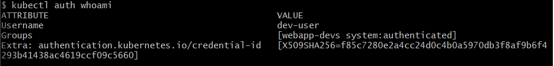

### Check 2: Rights inside

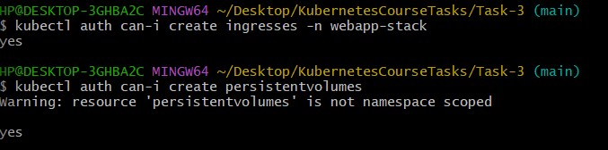

### Check 3: No rights outside

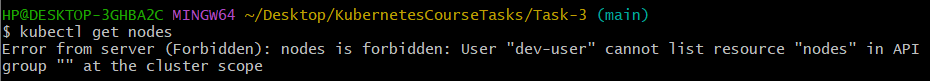

### Check 4: Release

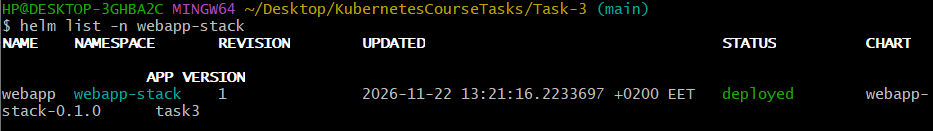

### Check 5: Objects

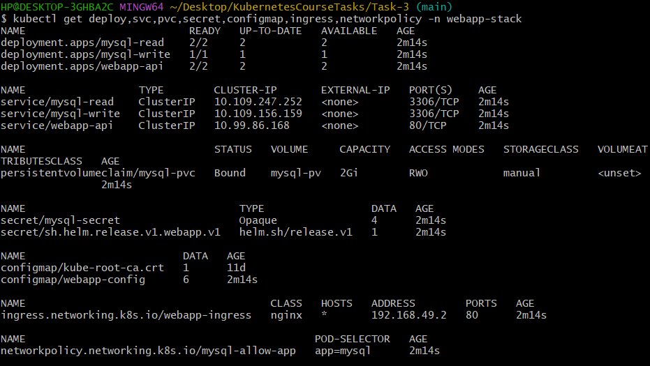

### Check 6: Replicas and images

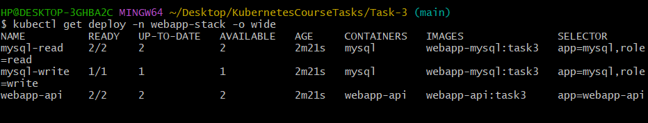

### Check 7: Folders (admin)

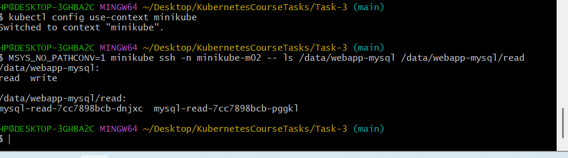

### Check 8: Replication

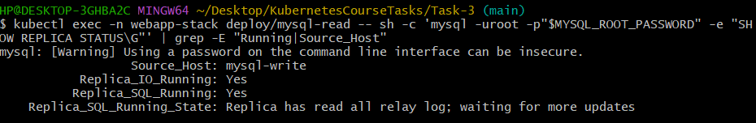

### Check 9: Read-only replica

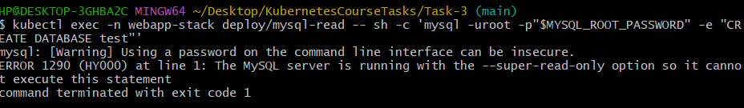

### Check 10: App config

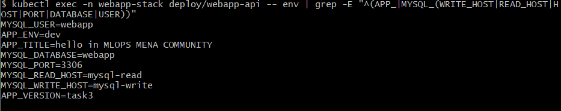

### Check 11: App info

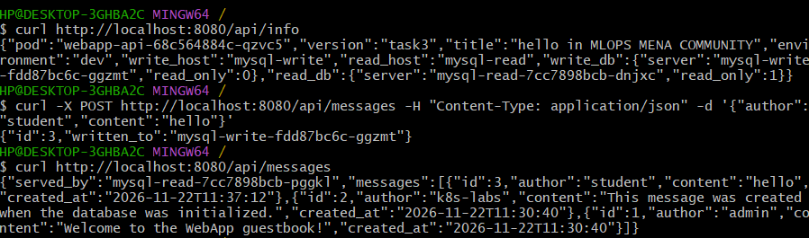

### Check 12: Write / read


### Check 13: App reaches MySQL

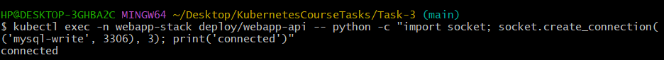

### Check 14: Others blocked

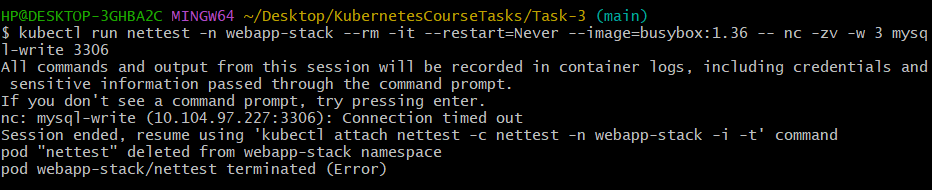

### Check 15: Helm values

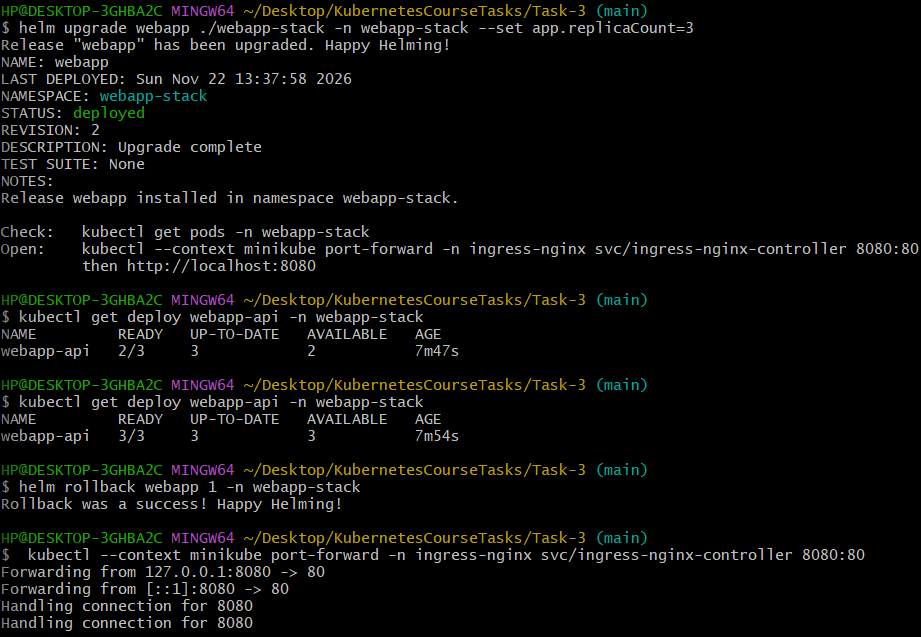
I upgraded the Task 2 stack:
 
- MySQL is now split into **`mysql-write`** (1 Pod, accepts writes) and **`mysql-read`** (2 Pods, read-only copies).
- The read servers copy every change from the write server (**GTID replication**).
- The app sends writes to `mysql-write` and reads to `mysql-read` (new ConfigMap keys `MYSQL_WRITE_HOST` and `MYSQL_READ_HOST`).
- I deployed as a new user **`dev-user`** that has rights only in `webapp-stack` (**RBAC**).
- A **NetworkPolicy** allows port 3306 only from the app and from MySQL Pods.
- Everything is packaged in one **Helm chart** (`webapp-stack`) and installed as release `webapp`.
## 2. Project structure
 
```
Task-3/
├── mysql/          # MySQL image 
├── webapp/         # FastAPI image 
├── rbac/rbac.yaml  # Role, RoleBinding, ClusterRole, ClusterRoleBinding
├── scripts/        # create-user.sh, kubeconfig.sh
├── webapp-stack/   # Helm chart (Chart.yaml, values.yaml, templates/)
└── images/         # screenshots
```
 
